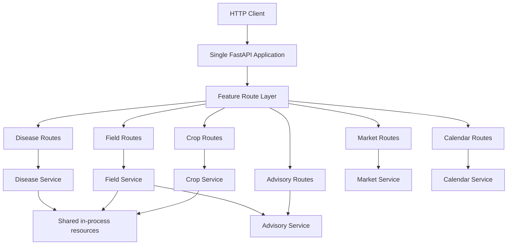

# AgriN Connect — Modular Monolithic Backend Architecture

## 1. Purpose and scope

This repository contains a **backend-only architectural implementation** based on the existing AgriN Connect FastAPI backend. It is not a rebuild of the React application and does not create independently deployed services.

The goal is to organize agricultural API functionality into cohesive Python modules while retaining one FastAPI application and one runtime/deployment unit.

## 2. Architectural style

The implementation follows a **modular monolith**:

- One FastAPI application is created in `app/main.py`.
- Feature routers are registered on that application.
- Routes call service functions directly through Python imports.
- Services contain business logic and compose other services through normal function calls when needed.
- Pydantic schemas validate request payloads.
- All modules run in the same Python process and are released together.

Having multiple files or folders does not make this a microservices architecture.

## 3. High-level component diagram



## 4. Layer responsibilities

| Layer | Responsibility | Example |
| --- | --- | --- |
| Application | Creates the FastAPI instance, configures middleware and registers routers | `app/main.py` |
| Routes | Defines HTTP methods, paths, request parsing and HTTP error handling | `app/routes/crop_routes.py` |
| Services | Implements agricultural business rules and response construction | `app/services/crop_service.py` |
| Schemas | Defines and validates API request data | `app/schemas/crop_schema.py` |
| Configuration | Holds application metadata, allowed origins, model path and upload limits | `app/config.py` |
| Model assets | Holds optional local ML checkpoint files | `app/models/` |

## 5. Feature ownership

| Feature | Route module | Service module | Schema |
| --- | --- | --- | --- |
| Health | `health_routes.py` | — | — |
| Crop recommendations | `crop_routes.py` | `crop_service.py` | `crop_schema.py` |
| Field intelligence | `field_routes.py` | `field_service.py` | `field_schema.py` |
| Regenerative actions | Composed into field-intelligence response | `advisory_service.py` | — |
| Disease classification | `disease_routes.py` | `disease_service.py` | `disease_schema.py` |
| Market context | `market_routes.py` | `market_service.py` | `market_schema.py` |
| Farmer calendar | `calendar_routes.py` | `calendar_service.py` | `calendar_schema.py` |
| Cooperation model card | `advisory_routes.py` | `advisory_service.py` | — |

The field service composes regenerative actions by calling `advisory_service.regenerative_actions()` directly in-process. This is an ordinary Python function call, not an HTTP request to another service.

## 6. Request lifecycle

1. A client sends an HTTP request to the FastAPI application.
2. FastAPI dispatches the request to the matching feature router.
3. Pydantic validates a JSON payload when the endpoint uses a request schema.
4. The route invokes a function in the corresponding service module.
5. A service may call another service function directly when responsibilities need to be composed.
6. FastAPI serializes the returned data and sends the HTTP response.

The route layer remains intentionally thin: it coordinates HTTP concerns, while service modules own business logic.

## 7. Disease inference lifecycle

The disease service validates upload type, size and image bytes. It then loads the trained PyTorch/timm model lazily, caching the loaded model and transform in process memory. It performs crop-scoped inference and applies the confidence threshold.

The checkpoint is not bundled by default because it is a binary model asset. The original AgriN Connect repository contains the checkpoint at `farmer-backend/models/agrismart-field-model.pt`. Copy the approved file to `app/models/agrismart-field-model.pt` to enable inference. If the checkpoint or required ML dependencies are missing, the endpoint responds with HTTP 503 rather than returning a fabricated prediction.

## 8. API surface

| Method | Path | Purpose |
| --- | --- | --- |
| GET | `/` | Backend status |
| GET | `/health` | Health check |
| POST | `/recommend_crop` | Crop suitability recommendations |
| POST | `/field-intelligence` | Field, soil, satellite-compatible and weather demo brief |
| POST | `/upload_image` | Plant disease image workflow |
| POST | `/predict_price` | Demo price and yield context |
| POST | `/farmer_calendar` | Farmer task calendar |
| GET | `/cooperation/model-card` | Advisory model card |

## 9. Runtime and deployment boundary

Run the application with:

```bash
uvicorn app.main:app --reload
```

This starts one ASGI application. All feature routers share the same process, configuration and release lifecycle. There are no per-feature servers, service discovery mechanisms, or internal HTTP calls.

## 10. Benefits and trade-offs

**Benefits**
- Clear separation of concerns without distributed-system complexity.
- Straightforward local development and debugging.
- Shared in-process resources, including the disease model.
- Easier focused tests for route and service behaviour.

**Trade-offs**
- Features share one release and scaling boundary.
- A resource-intensive feature can affect the same application process.
- Independent deployment or scaling of a module is not possible without a later architectural split.

## 11. Demo behaviour and production integration

Crop recommendations, field readings, market estimates and calendar entries are deterministic demo logic inherited from the prototype. They are not live agricultural, satellite, market or weather feeds.

Production systems can replace the relevant service implementations with validated regional agronomic rules, approved satellite/weather integrations, live market sources and a validated disease model while keeping the route/service separation intact.
