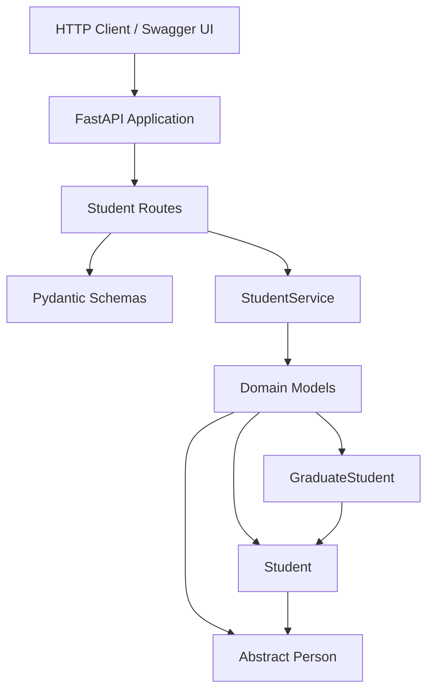

# OOP Student Management System — Modular Monolith with FastAPI

## 1. Overview

The application combines an object-oriented Student Management domain with a FastAPI REST interface. It is a **modular monolith**: routes, services, and models are cohesive modules inside one Python application and one deployment unit. Modules communicate through normal Python imports and function calls, not internal HTTP calls.

## 2. Architecture



## 3. Layer responsibilities

| Layer | Module | Responsibility |
|---|---|---|
| API application | `oops_student_manager/api.py` | Creates FastAPI app, includes routers, exposes health endpoints |
| Routes | `oops_student_manager/routes/student_routes.py` | HTTP methods, status codes, dependency injection, exception translation |
| Schemas | `oops_student_manager/schemas/student_schema.py` | Validates request payloads and documents response shape |
| Services | `oops_student_manager/services/student_service.py` | Manages the in-memory collection and student operations |
| Domain models | `oops_student_manager/models/` | OOP state, validation, grading, and behaviour |
| Console demo | `oops_student_manager/main.py` | Runs the standalone OOP demonstration |
| Tests | `tests/` | Tests domain logic, service operations, and HTTP endpoints |

## 4. OOP principles

- **Abstraction:** `Person` is an abstract base class requiring `display_details()`.
- **Encapsulation:** marks are stored in the private attribute `Student.__marks`; changes use the validated setter.
- **Inheritance:** `Student` extends `Person`; `GraduateStudent` extends `Student`.
- **Polymorphism:** `GraduateStudent` overrides `display_details()` and `calculate_grade()`.
- **Operator overloading:** adding two student objects returns the sum of their marks.
- **Class method:** `change_college()` updates the college name at class level.
- **Static method:** `is_adult()` evaluates an age without requiring an object.

## 5. HTTP request lifecycle

1. A client calls an endpoint, for example `POST /students`.
2. FastAPI parses the JSON request and validates it against `StudentCreate`.
3. The route receives a `StudentService` dependency.
4. The route constructs either a `Student` or `GraduateStudent` domain object.
5. The service stores that object by roll number.
6. The route maps the domain object to `StudentResponse`.
7. FastAPI serializes the response as JSON.

For marks updates, the route delegates to `StudentService.update_marks()`, which calls the model's validated `set_marks()` method. The API therefore does not bypass encapsulation.

## 6. API surface

| Method | Path | Result |
|---|---|---|
| GET | `/` | Welcome message |
| GET | `/health` | Health status |
| POST | `/students` | Create a student (201); duplicate roll number returns 409 |
| GET | `/students` | List students |
| GET | `/students/{roll_no}` | Read one student (404 when absent) |
| PATCH | `/students/{roll_no}/marks` | Update marks after validation |
| DELETE | `/students/{roll_no}` | Remove and return a student |

FastAPI's interactive API documentation is available at `/docs`.

## 7. Data storage and limitations

The service currently stores student objects in a Python dictionary in process memory. This keeps the project focused on OOP and API layering. The data is reset when the application restarts and is not shared across multiple worker processes. A future database repository can replace the in-memory storage behind the service boundary.

## 8. Run and test

Start the API:

```bash
uvicorn oops_student_manager.api:app --reload
```

Run the console demonstration:

```bash
python -m oops_student_manager.main
```

Run the test suite:

```bash
python -m pytest -q
```
