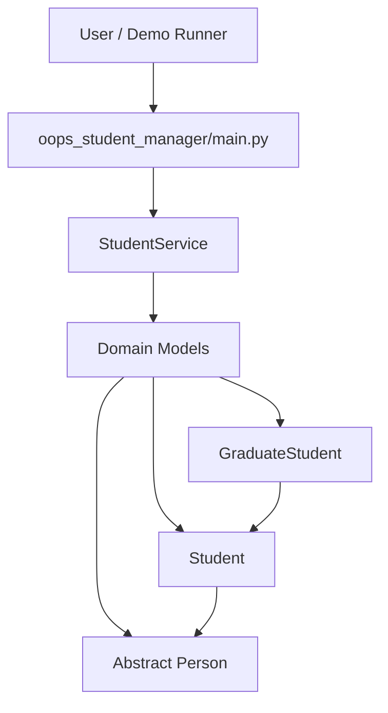

# OOP Student Management — Modular Monolith

## Goal

This package takes the single-file OOP Student Management example and separates it into cohesive Python modules. It is a **modular monolith**: the components run in one Python process and call each other through normal Python imports and method calls. It is not a microservices system.

## Component view



## Responsibilities

| Component | Responsibility |
|---|---|
| `main.py` | Composition root and runnable demonstration |
| `models/person.py` | Abstract person contract and common identity validation |
| `models/student.py` | Student state, marks encapsulation, grading, and OOP methods |
| `models/graduate_student.py` | Graduate-specific data and overridden behaviour |
| `services/student_service.py` | Add, find, list, update, and remove students |
| `tests/` | Behaviour and validation checks |

## Important design decisions

1. The model owns its invariants: marks are private and every write passes through validation.
2. The service owns collection operations and rejects duplicate roll numbers.
3. The service stores objects in memory to keep this educational example focused. A repository/database adapter can be added later without moving domain behaviour into the UI.
4. `main.py` creates dependencies and demonstrates behaviour; it does not contain the model implementation.
5. The package reuses the original OOP learning goals: abstraction, encapsulation, inheritance, polymorphism, operator overloading, class methods, and static methods.

## Execution flow

1. The demo creates a `StudentService`.
2. It constructs `Student` and `GraduateStudent` objects.
3. The service stores the objects by roll number.
4. The demo updates marks through the service, which delegates to the model's validated setter.
5. The demo uses overloaded addition to combine marks.
6. The demo iterates over student objects and calls the same method name, allowing Python's dynamic dispatch to select the graduate override where applicable.

## Run and test

```bash
python -m oops_student_manager.main
python -m pytest tests/test_oops_student_manager.py -q
```

The OOP package is independent of the repository's existing AgriN FastAPI application. Both can coexist in one repository but have separate entry points and responsibilities.
